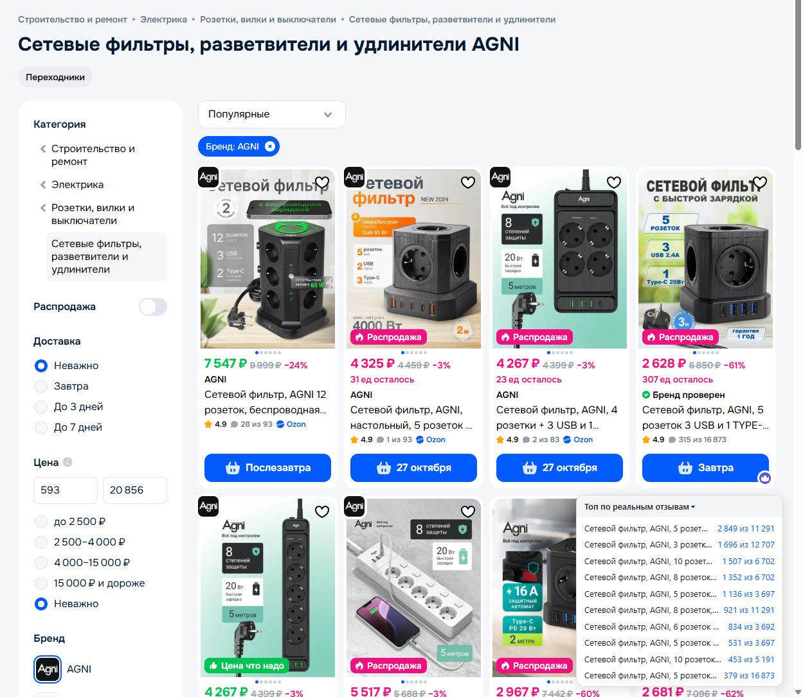

# Реальные отзывы SKU для Ozon

Расширение для Microsoft Edge (подходит и для Chrome), которое показывает в выдаче ozon.ru, сколько отзывов у **конкретного варианта товара**, а не у всей группы.

## Зачем

Ozon объединяет варианты товара (длина кабеля, число розеток, размер, цвет) в группу и на каждой карточке выдачи пишет общее число отзывов группы. Фильтр с 315 отзывами выглядит как хит с 16 873, и у нескольких разных вариантов в выдаче стоит одно и то же число.

Расширение меняет подпись на карточке:

```
16 873 отзыва   →   315 из 16 873
```

Справа внизу появляется панель **«Топ по реальным отзывам»**: 10 товаров с наибольшим числом отзывов на сам вариант среди уже загруженных карточек. Список пополняется при прокрутке.



## Установка

1. Скачайте `ozon-sku-reviews-<версия>.zip` со страницы [Releases](../../releases) и распакуйте.
2. Откройте `edge://extensions` (в Chrome — `chrome://extensions`).
3. Включите «Режим разработчика».
4. Нажмите «Загрузить распакованное» и выберите распакованную папку.

## Сборка из исходников

Нужен Node.js 24+.

```bash
npm ci
npm run build   # собирает расширение в dist/
npm test        # юнит-тесты
npm run zip     # упаковывает dist/ в zip
```

Затем загрузите папку `dist/` через «Загрузить распакованное».

## Как это работает

Для каждой карточки расширение делает тот же запрос, что и сайт Ozon на вкладке отзывов: `/product/<SKU>/reviews/pdp-part`. Число берётся из переключателя «Этот вариант товара (N)». Запросы идут медленно (не больше 2 одновременно, с паузой), видимые карточки — первыми. Результаты кэшируются в браузере на 6 часов. Если Ozon начинает ограничивать запросы, расширение сразу останавливается и пишет об этом в панели.

## Ограничения

- Расширение неофициальное и опирается на внутренний API Ozon. Если Ozon его изменит, подписи перестанут появляться до обновления расширения.
- Рейтинг (звёзды) остаётся групповым: Ozon не отдаёт рейтинг отдельного варианта.
- Если у товара нет вариантов, подпись не меняется: число отзывов и так его собственное.

## Приватность

Расширение ничего не собирает и никуда не отправляет. Запросы уходят только на ozon.ru от вашего имени, как при обычном просмотре сайта. Кэш хранится локально в браузере.

## Лицензия

[MIT](LICENSE)
